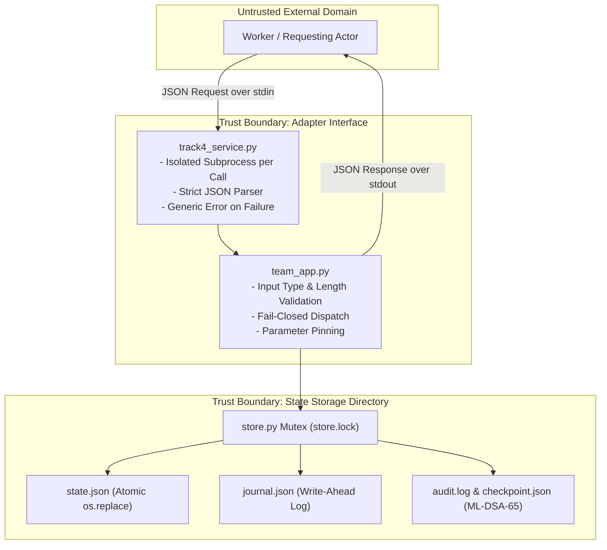

# Threat Model: Part C (Trust, But Verify)

## 1. System Overview & Scope
Part C implements the core trusted adapter interface, atomic on-disk state storage, tamper-evident audit logging, single-commit crash recovery, and post-quantum signed backups.

- **Primary Component:** Adapter service (`track4_service.py` -> `team_app.dispatch`)
- **Execution Model:** Fresh isolated process per request reading JSON from stdin and writing JSON to stdout.
- **Crypto Primitives:** SHA-256 (hash chaining & content hashing), HMAC-SHA-256 (possession proof), and post-quantum digital signatures via `pqcrypto.sign.ml_dsa_65` (FIPS 204).
- **Hard Constraints:** Imports restricted strictly to Python 3.12 standard library, `pqcrypto==0.4.0`, and internal project modules. No secrets in source code. State persisted only under `TRACK4_STATE_DIR` (fallback to system temp directory).

---

## 2. Protected Assets

| Asset | Description | Security Requirements |
| :--- | :--- | :--- |
| **Audit Log (`audit.log`)** | Chronological append-only record of security events and access decisions. | Append-only, integrity, tamper-evidence, non-repudiation. |
| **Revocation State (`state.json`)** | Set of permanently revoked actors and disabled identities. | Monotonicity (revocation of a key is permanent), persistence across process restarts, immune to rollback. |
| **Key & State Backups** | Exported archives of state and cryptographic metadata. | Authenticity, integrity, rollback protection (`key_version`). Never un-revokes any actor (`current.revoked UNION backup.revoked`). |
| **Protected Resources (`contents`)** | Sensitive stored asset bodies. | Confidentiality (disclosed only to authorized non-revoked owners). Zero disclosure on denied requests. |
| **Sensitive Seeds (`key_material`)** | Sensitive configuration/key seed. | Stored strictly in local state file; zero leakage to stdout, stderr, or audit logs. |

---

## 3. Trust Boundaries & Interfaces

1. **Boundary 1: Adapter Input Interface (`stdin` / `stdout` / `stderr`)**
   - Inputs are untrusted, potentially malformed, oversized, or malicious (e.g. JSON injection, path traversal, spoofed fields).
   - Outputs must never disclose protected bodies, shared secrets, or internal tracebacks on denial or failure.
2. **Boundary 2: Local State Directory (`TRACK4_STATE_DIR`)**
   - Process runs with standard user permissions in an offline Linux container.
   - Filesystem writes are confined to `TRACK4_STATE_DIR` (or tempdir fallback).
   - File locking prevents concurrent process race conditions with a stale-lock timeout.

---

## 4. Adversaries & Threat Scenarios

- **Adversary 1: Malicious / Revoked Client (Over the Adapter Interface)**
  - *Threat:* Attempts to read assets after revocation, exploit JSON deserialization, inject extra parameters (e.g. `actor_id` or `role`), or inject fake events via free-text newlines.
- **Adversary 2: Local Process Disruptor (Power Loss / Process Crasher)**
  - *Threat:* Crashes the service during state updates (e.g. during revocation) to leave state corrupted or undo a revocation.
- **Adversary 3: Backup Manipulator**
  - *Threat:* Modifies backup contents, attempts to restore an older state backup to un-revoke an actor, or presents an unauthorized backup with forged signatures.
- **Adversary 4: Audit Log Tamperer (Local Filesystem Observer)**
  - *Threat:* Edits mid-log audit records to hide access violations or truncates trailing denial events.

---

## 5. Security Controls & Defense Mapping

| Threat / Attack Vector | Architectural Defense | Proving Test in Test Suite |
| :--- | :--- | :--- |
| **Input Attacks & Fuzzing** | Schema validation, fail-closed access decisions on bad inputs, generic exit 1. | `tests/test_adapter.py::test_attack_input` |
| **Parameter Spoofing** (`actor_id` / `role` injected) | Actor identity is pinned strictly to validated `request["actor"]`. Extra fields are ignored. | `tests/test_adapter.py::test_attack_extra_fields` |
| **Path Traversal** (`../../`, device names, unicode) | Opaque identifier validation; state writes never leave `TRACK4_STATE_DIR`. | `tests/test_adapter.py::test_attack_path_traversal` |
| **Log Injection** (newlines & fake JSON) | Canonical JSON serialization encodes free-text values into standard string literals. | `tests/test_adapter.py::test_attack_log_injection` |
| **Access Control Enforcement** | Strict owner match, disabled actor denial, permanent revocation denial. Read and protected_read decisions match. | `tests/test_adapter.py::test_attack_access` |
| **State Persistence** | Monotonic revocation persistence across new processes; repeated setup yields fresh state. | `tests/test_adapter.py::test_attack_persistence` |
| **Mid-Log Tampering** | Each record contains `hash = SHA256(prefix \|\| prev_hash \|\| canonical_entry)`. Modifying any field invalidates the hash chain. | `tests/test_adapter.py::test_attack_log_tamper` |
| **Tail Log Truncation** | Atomic signed `checkpoint.json` binds current `seq` and `head` hash using ML-DSA-65 signatures. Deleting tail entries is caught immediately. | `tests/test_adapter.py::test_attack_log_tamper` |
| **Mid-Transaction Crash** | Write-ahead journal with single commit point (`os.replace`). Revocations roll forward; uncommitted non-revocations roll back. | `scripts/crash_test.py` (tested across 4 crash injection points) |
| **Revocation Rollback via Restore** | `restore_backup` performs union merge (`current.revoked UNION backup.revoked`). Revocation of a key is permanent; re-enrolment issues a NEW key. | `tests/test_adapter.py::test_attack_backup` |
| **Backup Tampering & Rollback** | Manifest containing SHA-256 of canonical state signed with ML-DSA-65. Signature and digest verified before touching state. Reject older `key_version`. | `tests/test_adapter.py::test_attack_backup` |
| **Concurrent Race Conditions** | File-based mutex with stale-lock detection ensures serialized atomicity without deadlock. | `tests/test_adapter.py::test_attack_concurrency` |
| **Diagnostic Information Leaks** | Global try/except handler catches all exceptions, suppressing tracebacks and writing generic error strings to stderr. | `tests/test_adapter.py::test_attack_leak_check` |
| **Protected Read End-to-End** | ML-KEM-768 encapsulation and HMAC-SHA256 proof over `challenge + stored_body`. | `tests/test_adapter.py::test_attack_messaging_end_to_end` |

---

## 6. Honest Exclusions & Known Limitations

1. **Signing Key Co-Location:**
   - *Limitation:* The audit signing key (`audit_signing_key.json`) is stored in the local state directory (`TRACK4_STATE_DIR`). Anyone who has write access to the state directory can generate a new key and re-sign an altered checkpoint.
   - *Mitigation:* Log verification cannot detect an attacker who rewrites both the log and the key. External verification requires publishing or anchoring the head hash out-of-band (supported via `verify_audit_log(..., anchor_head=...)`).
2. **Single-Node Simulation:**
   - *Limitation:* All nodes, processes, and state are simulated on one machine. Multi-node Byzantine consensus, distributed synchronization, and network partitioning are out of scope for Part C.
3. **Validator Scope:**
   - *Limitation:* The official validator (`validate.py`) tests only basic access operations and does NOT test post-quantum cryptography, latency, crash recovery, or protected_read interoperability. These are proven through our independent test suite (`tests/test_adapter.py` and `scripts/crash_test.py`).
4. **Host Compromise Out of Scope:**
   - *Limitation:* An attacker who controls the host operating system, root kernel, physical RAM, or hardware storage controller is out of scope.
