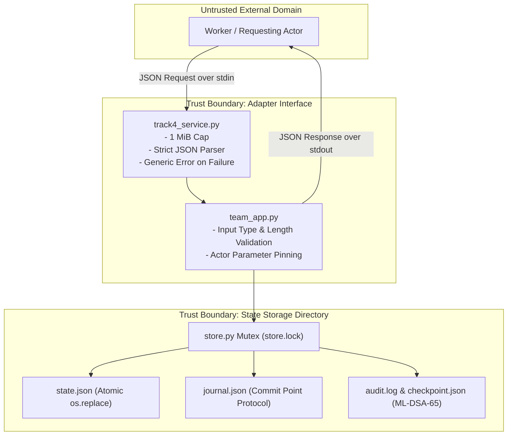

# Threat Model: Part C (Trust, But Verify)

## 1. System Overview & Scope
Part C implements the core trusted adapter interface, atomic on-disk state storage, tamper-evident audit logging, single-commit crash recovery, and post-quantum signed backups.

- **Primary Component:** Adapter service (`track4_service.py` -> `team_app.dispatch`)
- **Execution Model:** New isolated process per request reading JSON from stdin and writing JSON to stdout.
- **Crypto Primitives:** SHA-256 (hash chaining & content hashing), HMAC-SHA-256, and post-quantum digital signatures via `pqcrypto.sign.ml_dsa_65` (FIPS 204).

---

## 2. Protected Assets

| Asset | Description | Security Requirements |
| :--- | :--- | :--- |
| **Audit Log (`audit.log`)** | Chronological record of security events and access decisions. | Append-only, integrity, tamper-evidence, non-repudiation. |
| **Revocation State (`state.json`)** | Set of permanently revoked actors and disabled identities. | Persistence across process crashes, monotonicity (cannot be undone by restore). |
| **Key & State Backups** | Exported archives of state and cryptographic metadata. | Authenticity, integrity, rollback protection (`key_version`). |
| **Protected Resources (`contents`)** | Sensitive stored asset bodies. | Confidentiality (disclosed only to authorized non-revoked owners). |
| **Sensitive Seeds (`key_material`)** | Sensitive configuration/key seed. | Stored strictly in local state file; zero leakage to stdout, stderr, or audit logs. |

---

## 3. Trust Boundaries & Interfaces

1. **Boundary 1: Adapter Input Interface (`stdin` / `stdout` / `stderr`)**
   - Inputs are untrusted, potentially malformed, oversized, or malicious (e.g. JSON injection, path traversal, spoofed fields).
   - Outputs must never contain protected bodies for denied requests, sensitive seeds, or internal tracebacks.
2. **Boundary 2: Local State Directory (`TRACK4_STATE_DIR`)**
   - Process runs with standard user permissions in an offline container.
   - Filesystem writes are confined to `TRACK4_STATE_DIR` (or tempdir fallback).
   - File locking prevents concurrent process race conditions.

---

## 4. Adversaries & Threat Scenarios

- **Adversary 1: Malicious / Revoked Client (Over the Adapter Interface)**
  - *Threat:* Attempts to read assets after revocation, exploit JSON deserialization, inject extra parameters (e.g. `actor_id` to override `actor`), or inject fake events via free-text newlines.
- **Adversary 2: Local Process Disruptor (Power Loss / Process Crasher)**
  - *Threat:* Crashes the service during state updates (e.g. during revocation) to leave state corrupted or undo a revocation.
- **Adversary 3: Backup Manipulator**
  - *Threat:* Modifies backup contents, attempts to restore an older state backup to un-revoke an actor, or presents an unauthorized backup.
- **Adversary 4: Audit Log Tamperer (Local Filesystem Observer)**
  - *Threat:* Edits mid-log audit records to hide access violations or truncates trailing denial events.

---

## 5. Security Controls & Defense Mapping

| Threat / Attack Vector | Architectural Defense | Test Coverage in Test Suite |
| :--- | :--- | :--- |
| **Parameter Spoofing** (`actor_id` injected) | Actor identity is pinned strictly to validated `request["actor"]`. Extra fields are ignored. | `tests/test_adapter.py::test_extra_actor_id_cannot_change_recorded_actor` |
| **Log Injection** (newlines & fake JSON) | Canonical JSON serialization encodes free-text values into standard string literals. | `tests/test_adapter.py::test_newline_and_fake_json_injection_in_freetext` |
| **Mid-Log Tampering** | Each record contains `hash = SHA256(prefix \|\| prev_hash \|\| canonical_entry)`. Modifying any field invalidates the subsequent hash chain. | `tests/test_adapter.py::test_tampered_log_line_detected` |
| **Tail Log Truncation** | Atomic signed `checkpoint.json` binds the current `seq` and `head` hash using ML-DSA-65 signatures. Deleting tail entries results in seq/head mismatch. | `tests/test_adapter.py::test_deleting_last_entry_detected_via_checkpoint` |
| **Mid-Transaction Crash** | Write-ahead journal with single commit point (`os.replace`). Revocations are strictly roll-forward, re-applied idempotently on startup. | `scripts/crash_test.py` (tested across 4 crash injection points) |
| **Revocation Rollback via Restore** | `restore_backup` performs union merge (`current.revoked | backup.revoked`) ensuring revocations are monotonic and irreversible. | `tests/test_adapter.py::test_old_valid_backup_cannot_restore_revoked_actor` |
| **Backup Tampering** | Manifest containing SHA-256 of canonical state is signed with ML-DSA-65. Signature and digest verified before touching state. | `tests/test_adapter.py::test_damaged_backup_is_refused` |
| **Secret Leaks in Diagnostics** | Global try/except handler in `track4_service.py` catches all exceptions, suppressing tracebacks and writing generic error strings to stderr. | `tests/test_adapter.py::test_validator_11_behaviors` |

---

## 6. Honest Exclusions & Known Limitations

1. **Signing Key Co-Location:**
   - *Limitation:* The ML-DSA-65 audit log signing key is stored inside `TRACK4_STATE_DIR`. A privileged local attacker with write access to this directory could overwrite both the log, checkpoint, and private key.
   - *Mitigation:* The head hash can be published to an out-of-band external anchor (supported via `verify_audit_log(..., anchor_head=...)`).
2. **Single-Node Simulation:**
   - *Limitation:* State and crash recovery are demonstrated on a single machine/container. Multi-node distributed consensus and Byzantine fault tolerance are out of scope for Part C.
3. **KEM Protected Read Interface:**
   - *Status:* Madhu owns `app/kem.py`. The Part C adapter provides a secure stub raising `NotImplementedError` and auditing requests as `deny` until integrated.
4. **Denial of Service via Stale Lock:**
   - *Limitation:* A hard-killed process leaves a lock file.
   - *Mitigation:* Built-in dead-PID detection (`os.kill(pid, 0)`) and 1.5s stale-lock timeout automatically breaks abandoned locks.
